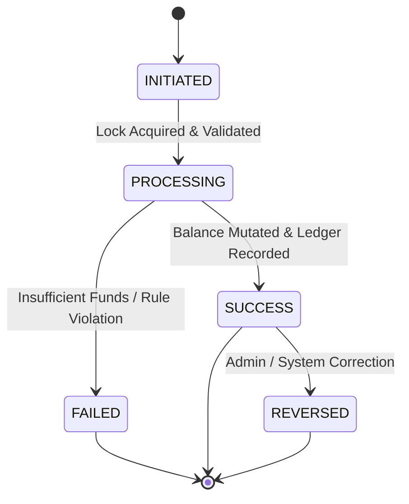

# Low-Level Design (LLD) - Coinpath

This document details the object-oriented structure, domain models, entity relationships, state machines, and design patterns utilized in Coinpath.

---

## 1. Domain Entities & Value Objects

### 1.1 Money (Value Object)
- **Attributes**:
  - `BigDecimal amount`: Scale 4, strictly positive or zero depending on operation context.
  - `Currency currency`: ISO-4217 standard (e.g. `INR`, `USD`).
- **Behavior**:
  - `add(Money other)`: Validates currency equality and returns new `Money` instance.
  - `subtract(Money other)`: Validates currency equality and sufficiency; returns new `Money` instance.
  - `isGreaterThanOrEqual(Money other)`: Compares amounts.
- **Invariants**: Immutable; never permits `null` currency or negative values when instantiated as an operative amount.

### 1.2 User (Entity)
- **Table**: `users`
- **Fields**:
  - `UUID id`: Primary Key.
  - `String email`: Unique, validated format.
  - `String passwordHash`: BCrypt salted hash.
  - `String fullName`: User's full name.
  - `UserRole role`: Enum (`ROLE_USER`, `ROLE_ADMIN`).
  - `UserStatus status`: Enum (`ACTIVE`, `SUSPENDED`, `DELETED`).
  - `Instant createdAt`, `Instant updatedAt`.

### 1.3 Wallet (Aggregate Root)
- **Table**: `wallets`
- **Fields**:
  - `UUID id`: Primary Key.
  - `UUID userId`: Foreign key to `users(id)`, unique constraint (one wallet per user).
  - `BigDecimal balance`: Current snapshot balance, `CHECK (balance >= 0)`.
  - `String currency`: ISO currency code (default: `INR`).
  - `WalletStatus status`: Enum (`ACTIVE`, `BLOCKED`, `CLOSED`).
  - `Long version`: Optimistic locking version column.
  - `Instant createdAt`, `Instant updatedAt`.
- **State Transitions**:
  - `ACTIVE` $\rightarrow$ `BLOCKED` (via risk/admin trigger)
  - `BLOCKED` $\rightarrow$ `ACTIVE` (via KYC/admin clearance)
  - `ACTIVE` $\rightarrow$ `CLOSED` (permitted only when balance is zero)

### 1.4 WalletTransaction (Entity)
- **Table**: `wallet_transactions`
- **Fields**:
  - `UUID id`: Primary Key.
  - `String referenceId`: Unique business transaction reference.
  - `UUID sourceWalletId`: Nullable (for deposits/add-money).
  - `UUID targetWalletId`: Nullable (for withdrawals).
  - `BigDecimal amount`: Transaction amount, strictly positive.
  - `String currency`: Currency code.
  - `TransactionType type`: Enum (`CREDIT`, `DEBIT`, `TRANSFER`, `REFUND`, `WITHDRAWAL`).
  - `TransactionStatus status`: Enum (`INITIATED`, `PROCESSING`, `SUCCESS`, `FAILED`, `REVERSED`).
  - `String failureReason`: Optional error description.
  - `Instant createdAt`, `Instant updatedAt`.

### 1.5 LedgerEntry (Entity - Immutable)
- **Table**: `ledger_entries`
- **Fields**:
  - `UUID id`: Primary Key.
  - `UUID transactionId`: Foreign key to `wallet_transactions(id)`.
  - `UUID walletId`: Foreign key to `wallets(id)`.
  - `EntryType entryType`: Enum (`DEBIT`, `CREDIT`).
  - `BigDecimal amount`: Magnitude of mutation, strictly positive.
  - `BigDecimal balanceAfter`: Snapshot of wallet balance immediately following this entry.
  - `String currency`: Currency code.
  - `Instant createdAt`: Immutable timestamp.
- **Rule**: Append-only; no update or delete mutations permitted.

### 1.6 Payment (Entity)
- **Table**: `payments`
- **Fields**:
  - `UUID id`: Primary Key.
  - `String paymentReference`: Unique external/internal payment reference.
  - `UUID userId`: Initiating user.
  - `UUID walletId`: Target wallet to credit upon success.
  - `BigDecimal amount`: Payment amount.
  - `String currency`: ISO currency.
  - `PaymentStatus status`: Enum (`INITIATED`, `PROCESSING`, `SUCCESS`, `FAILED`).
  - `String paymentMethod`: Enum (`WALLET`, `MOCK_GATEWAY`, `CARD`, `UPI`).
  - `String gatewayTransactionId`: Provider reference ID.
  - `Instant createdAt`, `Instant updatedAt`.

### 1.7 Refund (Entity)
- **Table**: `refunds`
- **Fields**:
  - `UUID id`: Primary Key.
  - `String refundReference`: Unique refund reference.
  - `UUID paymentId`: Foreign key to original `payments(id)`.
  - `BigDecimal amount`: Refund amount.
  - `String currency`: ISO currency.
  - `RefundStatus status`: Enum (`INITIATED`, `PROCESSING`, `SUCCESS`, `FAILED`).
  - `String reason`: Reason for refund.
  - `Instant createdAt`, `Instant updatedAt`.
- **Invariant**: $\sum \text{Refunds(paymentId)} \le \text{Payment.amount}$.

### 1.8 IdempotencyKey (Entity)
- **Table**: `idempotency_keys`
- **Fields**:
  - `UUID id`: Primary Key.
  - `UUID userId`: Scoped user identifier.
  - `String idempotencyKey`: Client-provided key.
  - `String requestPath`: Target API endpoint.
  - `String requestHash`: SHA-256 hash of payload to detect payload mutation under same key.
  - `Integer responseStatusCode`: HTTP status code returned.
  - `String responseBody`: Cached serialized response.
  - `Instant createdAt`, `Instant expiresAt`.
- **Constraint**: `UNIQUE (user_id, idempotency_key)`.

### 1.9 OutboxEvent (Entity)
- **Table**: `outbox_events`
- **Fields**:
  - `UUID id`: Primary Key.
  - `String aggregateType`: E.g. `WALLET`, `PAYMENT`, `TRANSFER`.
  - `String aggregateId`: Entity identifier.
  - `String eventType`: E.g. `TRANSFER_COMPLETED`, `PAYMENT_SUCCESS`.
  - `String payload`: JSON serialized domain event.
  - `OutboxStatus status`: Enum (`PENDING`, `PROCESSING`, `SENT`, `FAILED`).
  - `Integer retryCount`: Number of delivery attempts.
  - `Instant createdAt`, `Instant processedAt`.

### 1.10 AuditLog (Entity)
- **Table**: `audit_logs`
- **Fields**:
  - `UUID id`: Primary Key.
  - `UUID userId`: Action initiator.
  - `String action`: Business action name (e.g. `LOGIN`, `TRANSFER_COMPLETED`).
  - `String resourceType`: Affected resource (`WALLET`, `PAYMENT`).
  - `String resourceId`: Resource identifier.
  - `String ipAddress`: Client IP.
  - `String details`: JSON or textual context.
  - `Instant timestamp`.

---

## 2. State Machines & Transitions

### 2.1 Payment State Machine
- `INITIATED` $\rightarrow$ `PROCESSING` (Payment gateway invocation initiated)
- `PROCESSING` $\rightarrow$ `SUCCESS` (Gateway returns success; wallet credited and ledger written)
- `PROCESSING` $\rightarrow$ `FAILED` (Gateway declines or times out)

### 2.2 Refund State Machine
- `INITIATED` $\rightarrow$ `PROCESSING` (Validation: payment successful and refundable balance sufficient)
- `PROCESSING` $\rightarrow$ `SUCCESS` (Funds debited/credited; ledger appended)
- `PROCESSING` $\rightarrow$ `FAILED` (Refund threshold violation)

---

## 3. Design Patterns Used

1. **Strategy Pattern (`PaymentGateway`)**:
   - `PaymentGateway` interface with methods `initiatePayment()`, `verifyPayment()`, and `processRefund()`.
   - Implementations: `MockPaymentGateway`, `WalletPaymentGateway`.
   - Injected dynamically via `PaymentGatewayFactory` based on payment method.

2. **Repository Pattern (Spring Data JPA)**:
   - Strong separation between domain aggregates and relational queries.
   - Customized repository methods with `@Lock(LockModeType.PESSIMISTIC_WRITE)` for concurrency control.

3. **Factory Pattern**:
   - `LedgerEntryFactory` generates paired balanced debit/credit entries for atomic transfer transactions.

4. **Observer / Transactional Outbox Pattern**:
   - Business operations publish domain events into the local relational outbox table.
   - Outbox scheduler polls pending events and asynchronously emits them to Kafka topics.
